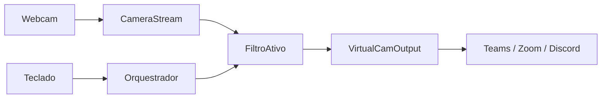

# Especificação técnica: Virtual Stream Engine (VSE)

## 1. Visão geral

O **Virtual Stream Engine (VSE)** é uma aplicação em Python que:

1. Captura frames de uma webcam física.
2. Aplica pipelines modulares de processamento (filtros estéticos, efeitos com landmarks faciais e manipulação de frames).
3. Publica o resultado em uma câmera virtual consumível por Microsoft Teams, Zoom, Discord e apps similares.

**Stack prevista:** OpenCV (captura), MediaPipe (face mesh), NumPy (blend), [pyvirtualcam](https://github.com/letmaik/pyvirtualcam) (saída virtual). No Linux, a câmera virtual costuma depender de `v4l2loopback`; no Windows, do driver OBS Virtual Camera ou equivalente.

---

## 2. Requisitos

### 2.1 Funcionais

| ID | Requisito |
|----|-----------|
| **RF01** | Consumir a webcam em **1280×720 @ 30 FPS**. |
| **RF02** | Expor o fluxo processado como dispositivo de vídeo virtual do SO. |
| **RF03** | **Filtro meme (fade):** congelar o fundo e fazer fade linear da pessoa (opacidade) com gatilhos de teclado. |
| **RF04** | **Filtro AR:** mapear landmarks faciais e sobrepor PNG transparente (ex.: óculos) com escala e rotação conforme a cabeça. |
| **RF05** | **Hot-swap:** alternar filtros em tempo real sem derrubar a transmissão. |

### 2.2 Não funcionais

| ID | Requisito |
|----|-----------|
| **RNF01** | Latência de processamento por frame **≤ 33,3 ms** (30 FPS estáveis). |
| **RNF02** | Novos filtros via novos módulos em `filters/`, sem alterar captura nem saída (aberto/fechado). |

### 2.3 Atalhos de teclado (contrato global)

| Tecla | Ação |
|-------|------|
| `1` | Filtro **normal** (pass-through). |
| `2` | Filtro **meme** (fade). |
| `3` | Filtro **AR** (face mesh). |
| `S` | No filtro meme: iniciar sumiço (fade out da pessoa). |
| `A` | No filtro meme: voltar a aparecer (fade in). |
| `Q` | Encerrar o loop e liberar hardware. |

O orquestrador trata troca de filtro (`1`–`3`) antes de delegar `handle_input` ao filtro ativo, para que `S`/`A` não conflitem com outras funções.

---

## 3. Arquitetura de pastas

```
filter-cv/
├── main.py                 # Orquestrador e game loop
├── camera_stream.py        # Entrada (OpenCV VideoCapture)
├── virtual_cam_output.py   # Saída (pyvirtualcam)
└── filters/
    ├── base_filter.py      # ABC VideoFilter
    ├── identity_filter.py  # Pass-through (filtro "normal")
    ├── fade_meme_filter.py # Meme / fade no fundo congelado
    └── face_mesh_filter.py # Overlays AR (MediaPipe)
```

Assets opcionais (ex.: `assets/oculos_thug_life.png`) ficam fora de `filters/` para não misturar lógica e recurso estático.

---

## 4. Contratos e pseudocódigo por componente

### 4.1 `filters/base_filter.py`

**Responsabilidade:** contrato abstrato do pipeline de vídeo.

```text
CLASSE VideoFilter (ABC):
    @abstractmethod
    METODO handle_input(tecla: int) -> None

    @abstractmethod
    METODO apply(frame: ndarray BGR) -> ndarray BGR
```

### 4.2 `filters/identity_filter.py`

**Responsabilidade:** filtro padrão sem efeito (hot-swap para “câmera crua” processada apenas pela cadeia de saída).

```text
CLASSE IdentityFilter IMPLEMENTA VideoFilter:
    METODO handle_input(tecla): passar
    METODO apply(frame): RETORNAR frame
```

### 4.3 `filters/fade_meme_filter.py`

**Responsabilidade:** estado do fundo congelado e interpolação linear de opacidade da pessoa sobre esse fundo.

```text
IMPORTAR VideoFilter DE filters.base_filter

CLASSE FadeMemeFilter IMPLEMENTA VideoFilter:
    fundo_limpo: ndarray
    alpha: float = 1.0          # 1 = pessoa visível, 0 = só fundo
    esta_sumindo: bool = False

    METODO __init__(frame_fundo_inicial):
        fundo_limpo = copia(frame_fundo_inicial)

    METODO handle_input(tecla):
        SE tecla == TECLA_S: esta_sumindo = True
        SE tecla == TECLA_A: esta_sumindo = False

    METODO apply(frame):
        SE esta_sumindo E alpha > 0.0: alpha -= 0.05
        SENAO SE NAO esta_sumindo E alpha < 1.0: alpha += 0.05

        beta = 1.0 - alpha
        RETORNAR (frame.astype(float) * alpha) + (fundo_limpo.astype(float) * beta)
        # converter de volta para uint8 BGR antes de enviar à câmera virtual
```

**Nota:** `fundo_limpo` deve ser capturado com a pessoa fora do quadro ou em pose neutra; o fluxo de UX em `capturar_fundo_estatico()` orienta o usuário.

### 4.4 `filters/face_mesh_filter.py`

**Responsabilidade:** MediaPipe Face Mesh, geometria olho–olho e composição alpha do overlay.

```text
IMPORTAR VideoFilter DE filters.base_filter

CLASSE FaceMeshFilter IMPLEMENTA VideoFilter:
    modelo: MediaPipe FaceMesh
    textura_asset: ndarray BGRA

    METODO __init__(caminho_png):
        modelo = inicializar_face_mesh()
        textura_asset = carregar_png_com_alpha(caminho_png)

    METODO handle_input(tecla): passar

    METODO apply(frame):
        landmarks = modelo.process(frame)
        SE landmarks ausentes: RETORNAR frame

        olho_esq = landmarks[33]
        olho_dir = landmarks[263]
        nariz    = landmarks[1]   # ou índice estável na ponte nasal

        distancia = norma(olho_esq - olho_dir)
        angulo    = atan2(dy_olhos, dx_olhos)

        overlay = redimensionar_e_rotacionar(textura_asset, distancia, angulo)
        RETORNAR mesclar_bgra(frame, overlay, ancora=nariz)
```

Índices de landmarks seguem o mapa oficial do MediaPipe; ajustar âncora (`nariz` vs centro entre olhos) conforme o asset.

### 4.5 `camera_stream.py`

**Responsabilidade:** abstrair `cv2.VideoCapture` (abertura, resolução, leitura, release).

```text
CLASSE CameraStream:
    captura: cv2.VideoCapture

    METODO __init__(device_id=0, largura=1280, altura=720, fps=30):
        captura = VideoCapture(device_id)
        definir CAP_PROP_FRAME_WIDTH, FRAME_HEIGHT, FPS

    METODO obter_frame() -> ndarray | None:
        ok, frame = captura.read()
        RETORNAR frame SE ok SENAO None

    METODO capturar_fundo_estatico(segundos=2) -> ndarray:
        avisar usuário para sair do quadro
        aguardar segundos
        RETORNAR obter_frame()

    METODO liberar():
        captura.release()
```

### 4.6 `virtual_cam_output.py`

**Responsabilidade:** enviar frames BGR/RGB no formato exigido pelo backend do pyvirtualcam e respeitar o relógio de FPS.

```text
CLASSE VirtualCamOutput:
    cam: pyvirtualcam.Camera

    METODO __init__(largura=1280, altura=720, fps=30):
        cam = Camera(width, height, fps, fmt=PixelFormat apropriado)

    METODO enviar(frame_bgr):
        converter cor se necessário
        cam.send(frame)
        cam.sleep_until_next_frame()

    METODO fechar():
        cam.close()
```

### 4.7 `main.py`

**Responsabilidade:** composição (DI), janela de preview opcional, hot-swap, loop principal.

```text
IMPORTAR CameraStream, VirtualCamOutput
IMPORTAR IdentityFilter, FadeMemeFilter, FaceMeshFilter

CLASSE VirtualStreamEngine:
    input_hw: CameraStream
    output_hw: VirtualCamOutput
    filtros: dict[str, VideoFilter]
    filtro_atual: VideoFilter

    METODO __init__():
        input_hw = CameraStream(0, 1280, 720, 30)
        fundo = input_hw.capturar_fundo_estatico()

        filtros = {
            "normal": IdentityFilter(),
            "meme":   FadeMemeFilter(fundo),
            "ar":     FaceMeshFilter("assets/oculos_thug_life.png"),
        }
        filtro_atual = filtros["normal"]
        output_hw = VirtualCamOutput(1280, 720, 30)

    METODO executar():
        ENQUANTO ativo:
            frame = input_hw.obter_frame()
            SE frame é None: continuar

            tecla = ler_tecla()  # ex.: cv2.waitKey na janela de preview

            SE tecla == "1": filtro_atual = filtros["normal"]
            SE tecla == "2": filtro_atual = filtros["meme"]
            SE tecla == "3": filtro_atual = filtros["ar"]
            SE tecla == "Q": quebrar

            filtro_atual.handle_input(tecla)
            frame_out = filtro_atual.apply(frame)
            output_hw.enviar(frame_out)

        input_hw.liberar()
        output_hw.fechar()

SE __name__ == "__main__":
    VirtualStreamEngine().executar()
```

---

## 5. Fluxo de dados



---

## 6. Critérios de aceite (MVP)

1. Com o VSE rodando, o SO lista uma câmera virtual e o Teams (ou `ffplay`/`v4l2`) exibe o preview.
2. Teclas `1`/`2`/`3` trocam o efeito sem travar o vídeo por mais de um frame.
3. No filtro meme, `S` reduz a opacidade da pessoa até revelar o fundo congelado; `A` restaura.
4. No filtro AR, com rosto visível, o overlay acompanha escala e inclinação da cabeça de forma estável em 720p30.
5. `Q` encerra sem vazar handle de câmera (sem dispositivo preso após o processo morrer).

---

## 7. Extensões futuras (fora do MVP)

- Registro de filtros por plugin (`filters/__init__.py` exportando um registry).
- Filtros com estado compartilhado (ex.: blur de fundo com segmentação).
- Métricas de FPS e latência na UI de preview.
- Configuração via arquivo (`config.yaml`) para device id, resolução e paths de assets.
