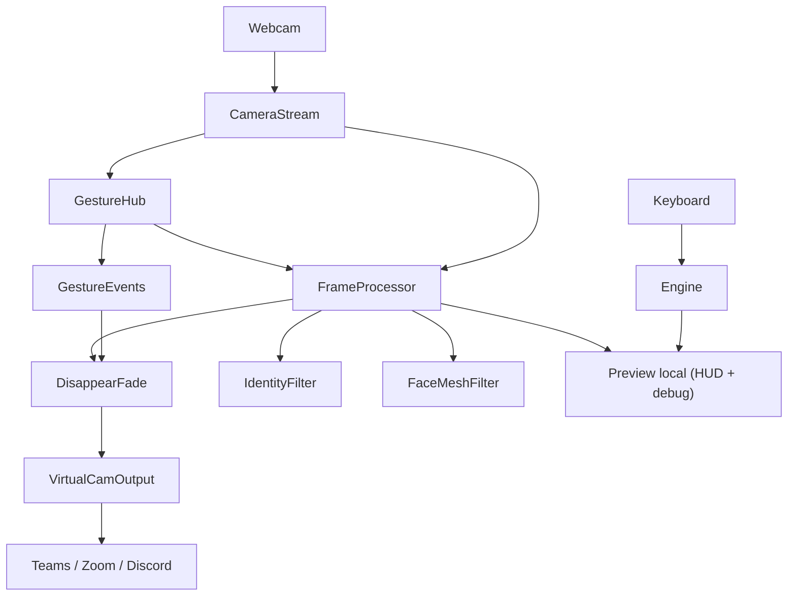

# Especificação técnica: Virtual Stream Engine (VSE)

> **Implementação:** Poetry, Python 3.12+, pacote na raiz do repositório (`package-mode = false`).  
> **Instalação e uso diário:** [README.md](../README.md). **Onde editar o código:** [§8 Guia de manutenção](#8-guia-de-manutenção).

## 1. Visão geral

O **Virtual Stream Engine (VSE)** é uma aplicação em Python que:

1. Captura frames de uma webcam física.
2. Interpreta **gestos** (mão + rosto) para **ações** e **modos** de filtro.
3. Aplica um pipeline modular de vídeo (pass-through, overlay AR, fade sobre fundo congelado).
4. Publica o resultado em uma câmera virtual consumível por Microsoft Teams, Zoom, Discord e apps similares.

**Stack:**

| Camada | Tecnologia |
|--------|------------|
| Captura | OpenCV `VideoCapture` |
| Gestos / landmarks | MediaPipe **Tasks** — `HandLandmarker` + `FaceLandmarker` |
| Processamento | NumPy, composição BGRA |
| Saída virtual | [pyvirtualcam](https://github.com/letmaik/pyvirtualcam) (`PixelFormat.BGR`) |
| Empacotamento | Poetry |

No Linux, a câmera virtual costuma depender de `v4l2loopback`; no Windows, do driver OBS Virtual Camera ou equivalente.

### 1.1 Conceitos

| Conceito | Descrição |
|----------|-----------|
| **Filtro** | Transformação de vídeo por frame (`VideoFilter`), registrada em `filters/catalog.py`. |
| **Ação** | Efeito com estado (ex.: fade no fundo) acionado por **gesto**, não por tecla de modo. |
| **Gesto** | Heurística sobre landmarks → evento estável no `GestureSnapshot`. |
| **Modo AR** | Estado booleano no `GestureHub` (`ar_enabled`); óculos aplicados no pipeline quando ativo. |

---

## 2. Requisitos

### 2.1 Funcionais

| ID | Requisito | Estado |
|----|-----------|--------|
| **RF01** | Consumir a webcam em **1280×720 @ 30 FPS** (configurável em `config/settings.py`). | Implementado |
| **RF02** | Expor o fluxo processado como dispositivo de vídeo virtual do SO. | Implementado |
| **RF03** | **Ação peace-out:** fundo congelado na inicialização; ✌️ estável dispara fade linear da pessoa. | Implementado |
| **RF04** | **Retorno do fade:** punho fechado (e fallback tecla `A`) restaura opacidade. | Implementado |
| **RF05** | **AR óculos:** overlay PNG BGRA alinhado a landmarks faciais (escala/rotação olho–olho). | Implementado |
| **RF06** | **Toggle AR por gesto:** toque intencional (indicador perto do olho) liga/desliga óculos. | Implementado |
| **RF07** | **Debug:** exibir landmarks de mão/rosto no preview local (tecla `D`), sem enviar à câmera virtual. | Implementado |
| **RF08** | Pipeline contínuo: gestos e filtros sem reiniciar a transmissão virtual. | Implementado |

### 2.2 Não funcionais

| ID | Requisito |
|----|-----------|
| **RNF01** | Meta de latência por frame **≤ 33,3 ms** (30 FPS). *Dupla inferência mão+rosto pode exigir tuning em hardware modesto.* |
| **RNF02** | Novos **filtros** via `filters/catalog.py` + módulo em `filters/`, sem alterar `camera_stream` nem `virtual_cam_output`. |
| **RNF03** | Novos **gestos** via `core/gestures/` + integração em `hub.py` / `gesture_events.py`. |
| **RNF04** | Configuração central em `config/settings.py` (sensibilidade de gestos, paths, resolução). |

### 2.3 Gestos (contrato principal)

| Gesto | Condição (resumo) | Efeito |
|-------|-------------------|--------|
| **Peace out** ✌️ | Indicador+médio estendidos; anelar/mindinho fechados; mão ≥ `min_hand_span_ratio` da largura do frame; `gesture_stable_frames` consecutivos | `peace_out` → inicia fade out |
| **Punho** | Dedos recolhidos; estável N frames | `fade_in` → restaura pessoa |
| **Toque no olho** | Pose de indicador; ponta do indicador dentro de `eye_touch_radius_factor × distância interocular` de um olho; debounce/cooldown | `toggle_ar` → alterna `ar_enabled` |

Heurísticas detalhadas: `core/gestures/hand_pose.py`, `core/gestures/eye_touch.py`. Debounce e cooldown: `core/gestures/hub.py`.

### 2.4 Teclado (auxiliar)

| Tecla | Ação |
|-------|------|
| `D` | Liga/desliga desenho de landmarks no **preview** |
| `A` | Fade in (fallback, mesma ação que punho) |
| `Q` | Encerrar loop e liberar hardware |

Teclas de modo `1`/`2`/`3` e `S` do MVP original **não** fazem parte do contrato atual.

---

## 3. Arquitetura de pastas

```
filter-cv/
├── main.py                      # Entrada CLI → VirtualStreamEngine
├── pyproject.toml / poetry.toml
├── config/
│   └── settings.py              # StreamConfig
├── core/
│   ├── engine.py                # Loop + lifecycle
│   ├── frame_processor.py       # identity → AR? → disappear
│   ├── gesture_events.py
│   ├── keyboard_handler.py
│   ├── preview.py
│   ├── camera_stream.py
│   ├── virtual_cam_output.py
│   ├── keys.py
│   ├── gesture_hub.py           # Reexport GestureHub / GestureSnapshot
│   └── gestures/
│       ├── hub.py               # MediaPipe + estabilidade + AR toggle
│       ├── hand_pose.py
│       ├── eye_touch.py
│       └── types.py
├── filters/
│   ├── context.py               # FilterFactoryContext
│   ├── catalog.py               # FILTER_FACTORIES
│   ├── registry.py              # build_filters()
│   ├── base_filter.py
│   ├── identity_filter.py
│   ├── face_mesh_filter.py
│   ├── ar/
│   │   ├── landmarks.py
│   │   └── glasses_renderer.py
│   └── actions/
│       └── disappear_fade.py
├── utils/
│   ├── mediapipe/models.py
│   ├── mediapipe/debug_draw.py
│   └── bgra/
│       ├── assets.py
│       └── blend.py
├── assets/                      # PNGs, modelos .task (cache)
├── scripts/
└── docs/
    └── spec.md                  # Este documento
```

Assets estáticos (`assets/oculos_thug_life.png`, `assets/models/*.task`) ficam fora de `filters/` para separar lógica e recurso.

---

## 4. Contratos por componente

### 4.1 `filters/base_filter.py` — `VideoFilter`

```text
CLASSE VideoFilter (ABC):
    handle_input(tecla: int) -> None
    apply(frame BGR, face_landmarks opcional) -> frame BGR uint8
    close() -> None   # opcional; libera recursos nativos
```

Landmarks faciais vêm do `GestureHub` (uma inferência por frame), não de segundo `FaceLandmarker` no filtro.

### 4.2 `filters/catalog.py` + `registry.py`

```text
FILTER_FACTORIES: dict[str, Callable[FilterFactoryContext, VideoFilter]]
build_filters(ctx) -> dict[str, VideoFilter]
```

Filtros atuais: `normal` (`IdentityFilter`), `ar` (`FaceMeshFilter`).

### 4.3 `filters/actions/disappear_fade.py` — `DisappearFadeAction`

```text
CLASSE DisappearFadeAction:
    __init__(background_frame)
    start_fade_out() / start_fade_in()
    apply(frame) -> blend linear alpha sobre background congelado
```

Não implementa `VideoFilter`; é camada **pós-filtro** em `FrameProcessor`.

### 4.4 `filters/ar/glasses_renderer.py`

```text
render_glasses(frame, face_landmarks, asset_bgra) -> frame
    olhos: landmarks 33, 263; âncora: 1 (ponte nasal)
    largura overlay ∝ distância interocular; rotação = atan2 entre olhos
```

### 4.5 `core/gestures/hub.py` — `GestureHub`

```text
update(frame_bgr) -> GestureSnapshot
    hand_landmarks, face_landmarks
    peace_out, fade_in, toggle_ar  (borda, após estabilidade)
    ar_enabled: bool (estado do modo óculos)
close()
```

Modelos: `utils/mediapipe/models.py` (download sob demanda).

### 4.6 `core/camera_stream.py` — `CameraStream`

```text
read_frame() -> ndarray | None
capture_static_background(seconds) -> ndarray   # UX: usuário sai do quadro
release()
```

### 4.7 `core/virtual_cam_output.py` — `VirtualCamOutput`

```text
send(frame_bgr)   # send + sleep_until_next_frame
close()
```

### 4.8 `core/engine.py` — `VirtualStreamEngine`

```text
__init__: monta CameraStream, GestureHub, FrameProcessor, DisappearFadeAction, VirtualCamOutput
run():
    loop:
        frame = read
        snap = gestures.update(frame)
        apply_gesture_events(snap)
        teclas = keyboard_handler
        out = frame_processor.process(frame, snap, ar_enabled)
        virtual_cam.send(out)
        preview opcional
shutdown(): idempotente
```

Entrada: `main.py` ou `poetry run vse`.

---

## 5. Fluxo de dados



Ordem no `FrameProcessor`: **normal → AR (se `ar_enabled`) → disappear fade**.

---

## 6. Critérios de aceite

1. Com o VSE rodando, o SO lista uma câmera virtual e um app de vídeo exibe o preview do dispositivo virtual.
2. Na inicialização, o usuário sai do quadro ~2 s; o fundo é capturado para a ação peace-out.
3. ✌️ estável faz a pessoa sumir gradualmente sobre o fundo congelado; punho (ou `A`) restaura.
4. Toque no olho alterna óculos AR; com rosto visível, o overlay acompanha cabeça em 720p30 de forma aceitável.
5. `D` alterna landmarks apenas no preview; o stream virtual não mostra os pontos.
6. `Q` encerra sem vazar handle de câmera física ou virtual.

---

## 7. Extensões futuras

| Item | Notas |
|------|--------|
| `config.yaml` | Substituir ou complementar `config/settings.py` |
| Métricas FPS/latência no preview | `core/preview.py` |
| Blur de fundo / segmentação | Novo filtro + possivelmente modelo extra |
| Mais ações por gesto | Padrão: `types.py` → `hub.py` → `gesture_events.py` → `frame_processor.py` |
| Plugins de filtro | Evolução de `catalog.py` (entry points / descoberta dinâmica) |

---

## 8. Guia de manutenção

Use esta seção para saber **onde editar** sem percorrer o projeto inteiro.

### 8.1 Tabela de referência

| O que você quer fazer | Arquivo(s) | Notas |
|----------------------|------------|--------|
| **Novo gesto** (ex.: acenar) | `core/gestures/hand_pose.py` ou `eye_touch.py` | Heurística pura em landmarks normalizados |
| **Disparar ação ao reconhecer gesto** | `core/gestures/hub.py` | Debounce, cooldown, flags no `GestureSnapshot` |
| **Novo campo no resultado do frame** | `core/gestures/types.py` | `GestureSnapshot` |
| **Log / efeito ao disparar evento** | `core/gesture_events.py` | Peace, punho, toggle AR |
| **Sensibilidade dos gestos** | `config/settings.py` | `gesture_stable_frames`, `min_hand_span_ratio`, `eye_touch_radius_factor` |
| **Novo filtro de vídeo** | `filters/catalog.py` + classe em `filters/` | Implemente `VideoFilter` (`base_filter.py`) |
| **Tipos do factory de filtros** | `filters/context.py` | `FilterFactoryContext` |
| **Montar lista de filtros** | `filters/registry.py` | `build_filters()` — raramente precisa mudar |
| **Óculos / overlay AR** | `filters/ar/glasses_renderer.py`, asset em `assets/` | Landmarks em `filters/ar/landmarks.py` |
| **Ação “sumir” (fade)** | `filters/actions/disappear_fade.py` | Velocidade: `_ALPHA_STEP` |
| **Ordem do pipeline** | `core/frame_processor.py` | normal → AR → fade |
| **Preview / HUD** | `core/preview.py` | Não vai para a câmera virtual |
| **Teclas globais** | `core/keyboard_handler.py`, constantes em `core/keys.py` |
| **Loop principal** | `core/engine.py` | Só orquestração; lógica pesada fica nos módulos acima |
| **Webcam entrada** | `core/camera_stream.py` | Resolução/FPS também em `config/settings.py` |
| **Câmera virtual saída** | `core/virtual_cam_output.py` |
| **Download modelos MediaPipe** | `utils/mediapipe/models.py` | URLs dos `.task` em `assets/models/` |
| **Desenho debug landmarks** | `utils/mediapipe/debug_draw.py` | Ligado com `D` no preview |
| **Composição PNG transparente** | `utils/bgra/assets.py`, `utils/bgra/blend.py` |
| **Resolução, device, paths** | `config/settings.py` | Futuro: YAML pode substituir este módulo |
| **Entrada CLI** | `main.py` | Delega para `core/engine.py` |
| **Requisitos e contratos** | `docs/spec.md` (este arquivo) | RF/RNF, arquitetura, aceite |

### 8.2 Fluxo de um frame

```
camera_stream.read_frame()
  → gesture_hub.update()     # mão + rosto, eventos no snapshot
  → gesture_events           # fade / log AR
  → keyboard_handler         # D, A, Q
  → frame_processor          # identity → AR (se on) → disappear
  → virtual_cam_output.send()
  → preview (opcional)
```

### 8.3 Estrutura de pastas (implementação)

```
main.py
config/settings.py
docs/spec.md

core/
  engine.py
  frame_processor.py
  gesture_events.py
  keyboard_handler.py
  preview.py
  camera_stream.py
  virtual_cam_output.py
  keys.py
  gesture_hub.py          # reexport: GestureHub, GestureSnapshot
  gestures/
    hub.py
    hand_pose.py
    eye_touch.py
    types.py

filters/
  context.py
  catalog.py
  registry.py
  base_filter.py
  identity_filter.py
  face_mesh_filter.py
  ar/
    landmarks.py
    glasses_renderer.py
  actions/
    disappear_fade.py

utils/
  mediapipe/
    models.py
    debug_draw.py
  bgra/
    assets.py
    blend.py

assets/
scripts/
```

### 8.4 Checklist: novo filtro

1. Criar `filters/meu_filtro.py` herdando `VideoFilter`.
2. Registrar factory em `filters/catalog.py` (`FILTER_FACTORIES`).
3. Se o filtro depende de gesto, estender `GestureSnapshot` + `hub.py` + `gesture_events.py` + `frame_processor.py`.
4. Rodar `poetry run pyright .` na raiz do projeto.

### 8.5 Checklist: novo gesto

1. Função de detecção em `hand_pose.py` ou `eye_touch.py`.
2. Usar em `gestures/hub.py` (`_poses_this_frame` + estabilidade em `_apply_stability`).
3. Se gera ação nova, campo em `types.py` e handler em `gesture_events.py` (e pipeline se alterar vídeo).
